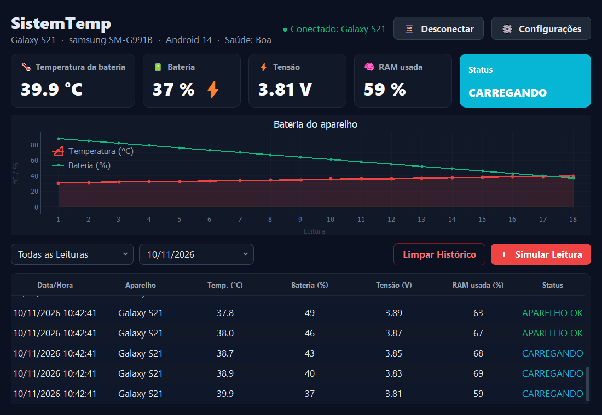

<p align="center">
  
</p>

<h1 align="center">SistemTemp</h1>

<p align="center">
  Monitor do aparelho conectado: o PC lê pelo cabo USB (adb), direto do kernel do celular Android, a temperatura e o nível da bateria, a tensão, a corrente, a temperatura da CPU, a RAM e a saúde da bateria, sem app nenhum no celular. Mostra tudo em tempo real, com alertas, gráfico e histórico filtrável. App desktop feito com Python e Qt.
</p>

<p align="center">
  
  
  
  
  
</p>

<p align="center">
  
</p>

> [!NOTE]
> Sem celular, o botão *Simular Leitura* gera uma leitura falsa do aparelho "Simulado". O histórico é salvo em SQLite (`database/systemp.db`, tabela `leituras`) e volta quando você abre o app de novo. O banco e o log (`logs/systemp.log`) são criados na primeira execução e ficam só no seu PC (não vão para o Git).

## Integrantes da Equipe

- **Samuel Schutz**
- **Gabriel Erharter**

## Funcionalidades

- **Leitura do celular pelo USB** (📱): sem app no celular. Mostra o nome do aparelho e o status (conectado, celular não encontrado, aguardando autorização).
- **Painel em tempo real**: cards com temperatura da bateria, nível da bateria (⚡ quando está carregando), tensão e RAM usada. Embaixo do título aparecem o nome, o modelo, a versão do Android, a saúde da bateria, a corrente, a temperatura da CPU e de onde veio cada dado (kernel ou dumpsys).
- **Status com cores**: verde para aparelho OK, vermelho para bateria quente, azul para bateria fria e laranja para bateria fraca.
- **Alertas**: um aviso aparece quando o aparelho *entra* em alerta (sem repetir a cada leitura).
- **Gráfico**: temperatura (°C) e nível da bateria (%) na mesma linha do tempo.
- **Histórico**: tabela com data/hora, aparelho, temperatura, bateria, tensão, RAM e status.
- **Filtros**: somente alertas e por data.
- **Configurações** (⚙): ajuste os limites de bateria quente, bateria fria e bateria fraca.
- **Logs**: eventos, alertas e erros vão para `logs/systemp.log`.
- **Limpar histórico** com confirmação, apagando a tabela, o gráfico e o banco.

## Como rodar

Você precisa do [Python](https://www.python.org) **3.13 ou mais novo**.

```sh
git clone https://github.com/SamuelSchutz13/SistemTemp.git
cd SistemTemp

python -m venv .venv
.venv\Scripts\activate          # Linux/macOS: source .venv/bin/activate
pip install -r requirements.txt

python main.py
```

Para rodar os testes: `pip install pytest` e depois `python -m pytest`.

### Leitura do celular pelo USB (adb)

O botão **📱 Conectar celular (USB)** lê um celular **Android** pelo cabo, sem instalar nada nele (o iPhone não deixa ler a bateria).

1. **PC:** instale o [Android SDK Platform-Tools](https://developer.android.com/tools/releases/platform-tools) e coloque a pasta `platform-tools` no PATH (ou deixe no local padrão do Android SDK, que o SistemTemp acha sozinho).
2. **Celular:** *Configurações > Sobre o telefone*, toque 7 vezes em *Número da versão*. Depois, em *Opções do desenvolvedor*, ligue a **Depuração USB**.
3. Ligue o cabo, clique em **📱 Conectar celular (USB)** e aceite o aviso *Permitir depuração USB?* no celular.

A cada 5 s o PC roda um `adb shell` que lê os arquivos onde os drivers do kernel publicam os sensores: `/sys/class/power_supply/battery/` (temperatura, nível, tensão, corrente, status, saúde) e `/sys/class/thermal/thermal_zone*` (CPU). Se o Android bloquear algum arquivo, o dado vem do `dumpsys battery`. Embaixo do título, *Fonte* diz o que veio direto do kernel.

Sem fio: no Android 11+, ligue a *Depuração por Wi-Fi* e rode `adb pair` e `adb connect` antes de clicar em conectar.

### Limites de alerta padrão

| Parâmetro                 | Padrão  | Alerta quando        |
| ------------------------- | ------- | -------------------- |
| Bateria quente            | `40 °C` | a temperatura passa dele |
| Bateria fria              | `10 °C` | a temperatura fica abaixo |
| Bateria fraca             | `20 %`  | o nível fica abaixo (mesmo carregando)     |

Dá para mudar tudo em **⚙ Configurações** com o app aberto.

## Estrutura do projeto

| Arquivo                                | O que faz                                                     |
| -------------------------------------- | ------------------------------------------------------------- |
| `main.py`                              | Ponto de entrada, abre a janela principal                     |
| `models/telemetry_model.py`            | Limites de alerta, status do aparelho, comando adb e interpretação da resposta, leitura simulada |
| `controllers/main_controller.py`       | Janela principal: cards, status e ações dos botões            |
| `controllers/grafico_controller.py`    | Gráfico de temperatura e nível da bateria (pyqtgraph)         |
| `controllers/historico_controller.py`  | Tabela de histórico, filtros e gravação no banco              |
| `controllers/config_controller.py`     | Diálogo de configuração e validação dos limites               |
| `controllers/adb_controller.py`        | Lê o celular pelo adb a cada 5 s                              |
| `database/connection.py`               | Conexão com o banco SQLite                                    |
| `utils/generate_log.py`                | Registro de eventos em `logs/systemp.log`                     |
| `ui/*.ui`                              | Layouts e estilos feitos no Qt Designer                       |
| `tests/`                               | Testes (pytest) da leitura do adb, dos status e do histórico |

## Como funciona

```
ui/*.ui (Qt Designer)  ──  loadUi  ──>  controllers (janela, gráfico, histórico, configurações)
                                               │
                          ┌────────────────────┼────────────────────┐
                          ▼                    ▼                    ▼
              models/telemetry_model.py   database/systemp.db   logs/systemp.log
                 (regras e limites)          (histórico)          (eventos)
```

A arquitetura segue o padrão **MVC**: as telas ficam nos arquivos `.ui`, as regras no model e os controllers ligam uma coisa à outra.
