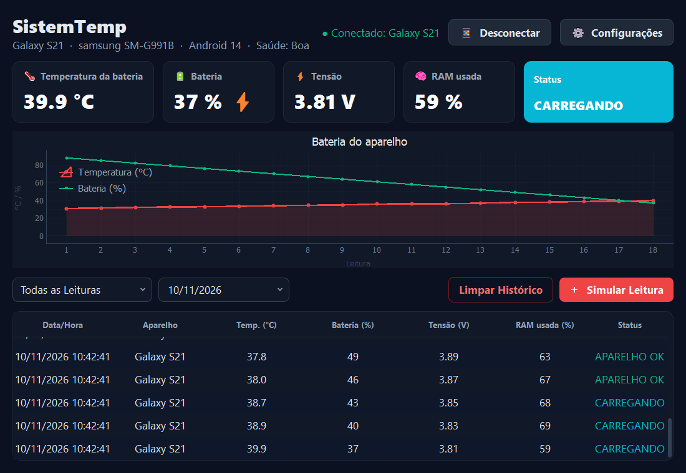

<p align="center">
  
</p>

<h1 align="center">SistemTemp</h1>

<p align="center">
  Monitor do aparelho conectado: o celular Android manda por Bluetooth a temperatura e o nível da bateria, a tensão, a RAM e a saúde da bateria, e o PC mostra tudo em tempo real, com alertas, gráfico e histórico filtrável. App desktop feito com Python e Qt, mais um app Android.
</p>

<p align="center">
  
  
  
  
  
</p>

<p align="center">
  
</p>

> [!NOTE]
> Sem celular, o botão *Simular Leitura* gera uma leitura falsa do aparelho "Simulado". O histórico é salvo em SQLite (`database/systemp.db`, tabela `leituras`) e volta quando você abre o app de novo. O banco e o log (`logs/systemp.log`) são criados na primeira execução e ficam só no seu PC (não vão para o Git).

## Integrantes da Equipe

- **Samuel Schutz**
- **Gabriel Erharter**

## Funcionalidades

- **Conexão Bluetooth com o celular** (📱): mostra o nome do aparelho conectado e o status da conexão (conectado, aguardando ou sem sinal).
- **Painel em tempo real**: cards com temperatura da bateria, nível da bateria (⚡ quando está carregando), tensão e RAM usada. Embaixo do título aparecem o nome, o modelo, a versão do Android e a saúde da bateria.
- **Status com cores**: verde para aparelho OK, ciano quando está carregando, vermelho para bateria quente, azul para bateria fria e laranja para bateria fraca.
- **Alertas**: um aviso aparece quando o aparelho *entra* em alerta (sem repetir a cada leitura).
- **Gráfico**: temperatura (°C) e nível da bateria (%) na mesma linha do tempo.
- **Histórico**: tabela com data/hora, aparelho, temperatura, bateria, tensão, RAM e status.
- **Filtros**: somente alertas, somente carregando, e por data.
- **Configurações** (⚙): ajuste os limites de bateria quente, bateria fria e bateria fraca.
- **App Android**: lê o aparelho a cada 5 s, guarda o próprio histórico de leituras (com botão 🗑 para excluí-lo) e envia ao PC quando conectado. Usa o mesmo ícone do app do PC.
- **Logs**: eventos, alertas e erros vão para `logs/systemp.log`.
- **Limpar histórico** com confirmação, apagando a tabela, o gráfico e o banco.

## Como rodar

Você precisa do [Python](https://www.python.org) **3.13 ou mais novo**.

```sh
git clone https://github.com/SamuelSchutz13/SistemTemp.git
cd SistemTemp

python -m venv .venv
.venv\Scripts\activate          # Linux/macOS: source .venv/bin/activate
pip install -r requirements.txt

python main.py
```

Para rodar os testes: `pip install pytest` e depois `python -m pytest`.

### Temperatura da bateria do celular (Bluetooth)

O botão **📱 Conectar celular** recebe as leituras de um celular **Android 8 ou mais novo** (o iPhone não deixa ler a bateria).

1. **Celular:** gere o app com `cd android` e `gradlew.bat assembleDebug` (Linux/macOS: `./gradlew assembleDebug`), ou abra a pasta no Android Studio. Precisa do Android SDK e do JDK 17. Depois instale `android/app/build/outputs/apk/debug/app-debug.apk` com `adb install -r` ou copiando o APK para o celular (permita *instalar apps de fontes desconhecidas*).
2. **Parear:** pareie o celular com o PC pelo Bluetooth do Windows.
3. **Porta COM:** no Windows, abra *Configurações > Bluetooth > Mais opções de Bluetooth > Portas COM > Adicionar > **Entrada***. Se não houver porta, o próprio SistemTemp oferece abrir essa janela.
4. **PC:** no SistemTemp, clique em **📱 Conectar celular** e escolha essa porta COM.
5. **Celular:** no app, toque em **Conectar ao PC** e escolha o PC. Ele manda uma leitura a cada 5 s enquanto ficar aberto. O ícone 🗑 ao lado do botão apaga o histórico guardado no celular (pede confirmação).

Cada leitura é uma linha JSON, por exemplo `{"temp": 36.5, "nivel": 82, "tensao": 4.12, "ram": 63, "carregando": true, "saude": "Boa", "nome": "Galaxy", "modelo": "samsung SM-G991B", "android": "14"}`. Só `temp` é obrigatório.

### Limites de alerta padrão

| Parâmetro                 | Padrão  | Alerta quando        |
| ------------------------- | ------- | -------------------- |
| Bateria quente            | `40 °C` | a temperatura passa dele |
| Bateria fria              | `10 °C` | a temperatura fica abaixo |
| Bateria fraca             | `20 %`  | o nível fica abaixo (e não está carregando) |

Dá para mudar tudo em **⚙ Configurações** com o app aberto.

## Estrutura do projeto

| Arquivo                                | O que faz                                                     |
| -------------------------------------- | ------------------------------------------------------------- |
| `main.py`                              | Ponto de entrada, abre a janela principal                     |
| `models/telemetry_model.py`            | Limites de alerta, status do aparelho, validação do JSON do celular e leitura simulada |
| `controllers/main_controller.py`       | Janela principal: cards, status e ações dos botões            |
| `controllers/grafico_controller.py`    | Gráfico de temperatura e nível da bateria (pyqtgraph)         |
| `controllers/historico_controller.py`  | Tabela de histórico, filtros e gravação no banco              |
| `controllers/config_controller.py`     | Diálogo de configuração e validação dos limites               |
| `controllers/bluetooth_controller.py`  | Recebe a temperatura da bateria do celular pela porta COM Bluetooth |
| `android/`                             | App Android: lê o aparelho, guarda o histórico e envia por Bluetooth |
| `database/connection.py`               | Conexão com o banco SQLite                                    |
| `utils/generate_log.py`                | Registro de eventos em `logs/systemp.log`                     |
| `ui/*.ui`                              | Layouts e estilos feitos no Qt Designer                       |
| `tests/`                               | Testes (pytest) da leitura do celular, dos status e do histórico |

## Como funciona

```
ui/*.ui (Qt Designer)  ──  loadUi  ──>  controllers (janela, gráfico, histórico, configurações)
                                               │
                          ┌────────────────────┼────────────────────┐
                          ▼                    ▼                    ▼
              models/telemetry_model.py   database/systemp.db   logs/systemp.log
                 (regras e limites)          (histórico)          (eventos)
```

A arquitetura segue o padrão **MVC**: as telas ficam nos arquivos `.ui`, as regras no model e os controllers ligam uma coisa à outra.
