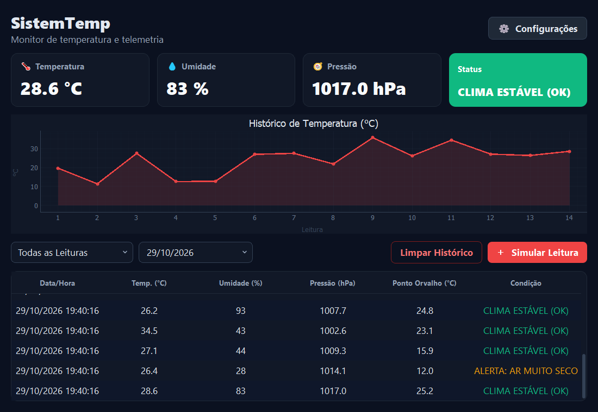

<p align="center">
  
</p>

<h1 align="center">SistemTemp</h1>

<p align="center">
  <a href="README.md">English</a> · <b>Português (Brasil)</b>
</p>

<p align="center">
  Monitor de temperatura e telemetria: acompanhe temperatura, umidade e pressão em tempo real, com alertas, gráfico e histórico filtrável. Tudo em um app desktop feito com Python e Qt.
</p>

<p align="center">
  
  
  
  
  
</p>

<p align="center">
  
</p>

> [!NOTE]
> **As leituras são simuladas.** O botão *Simular Leitura* gera valores aleatórios no lugar de um sensor. O histórico é salvo em um banco SQLite (`database/systemp.db`) e volta quando você abre o app de novo.

## Integrantes da Equipe

- **Samuel Schutz**
- **Gabriel Erharter**

## Funcionalidades

- **Tema escuro** em toda a janela.
- **Painel em tempo real**: cards com temperatura, umidade e pressão da última leitura.
- **Status com cores**: verde para clima estável, vermelho para calor extremo, azul para frio intenso e laranja para ar muito seco.
- **Alertas**: um aviso aparece quando a temperatura passa dos limites configurados.
- **Gráfico de temperatura**: cada leitura vira um ponto na linha do tempo.
- **Histórico**: tabela com data/hora, temperatura, umidade, pressão, ponto de orvalho e condição.
- **Filtros**: por faixa de temperatura (alta > 30 °C, baixa < 15 °C) e por data.
- **Configurações** (⚙): ajuste a temperatura máxima, a mínima e a umidade mínima de alerta. A máxima precisa ser maior que a mínima.
- **Histórico salvo**: as leituras ficam em SQLite e são recarregadas ao abrir o app.
- **Logs**: eventos, alertas e erros vão para `logs/systemp.log`.
- **Limpar histórico** com confirmação, apagando a tabela, o gráfico e o banco.

## Como rodar

Você precisa do [Python](https://www.python.org) **3.13 ou mais novo**.

```sh
git clone https://github.com/SamuelSchutz13/SistemTemp.git
cd SistemTemp

python -m venv .venv
.venv\Scripts\activate          # Linux/macOS: source .venv/bin/activate
pip install -r requirements.txt

python main.py
```

### Limites de alerta padrão

| Parâmetro                 | Padrão  | Alerta quando        |
| ------------------------- | ------- | -------------------- |
| Temperatura máxima        | `35 °C` | a leitura passa dele |
| Temperatura mínima        | `15 °C` | a leitura fica abaixo |
| Umidade mínima            | `30 %`  | a leitura fica abaixo |

Dá para mudar tudo em **⚙ Configurações** com o app aberto.

## Estrutura do projeto

| Arquivo                                | O que faz                                                     |
| -------------------------------------- | ------------------------------------------------------------- |
| `main.py`                              | Ponto de entrada, aplica o tema escuro e abre a janela principal |
| `models/telemetry_model.py`            | Limites de alerta, status climático, ponto de orvalho e leitura simulada |
| `controllers/main_controller.py`       | Janela principal: cards, status e ações dos botões            |
| `controllers/grafico_controller.py`    | Gráfico de temperatura (pyqtgraph)                            |
| `controllers/historico_controller.py`  | Tabela de histórico, filtros e gravação no banco              |
| `controllers/config_controller.py`     | Diálogo de configuração e validação dos limites               |
| `database/connection.py`               | Conexão com o banco SQLite                                    |
| `utils/generate_log.py`                | Registro de eventos em `logs/systemp.log`                     |
| `ui/*.ui`                              | Layouts e estilos feitos no Qt Designer                       |

## Como funciona

```
ui/*.ui (Qt Designer)  ──  loadUi  ──>  controllers (janela, gráfico, histórico, configurações)
                                               │
                          ┌────────────────────┼────────────────────┐
                          ▼                    ▼                    ▼
              models/telemetry_model.py   database/systemp.db   logs/systemp.log
                 (regras e limites)          (histórico)          (eventos)
```

A arquitetura segue o padrão **MVC**: as telas ficam nos arquivos `.ui`, as regras no model e os controllers ligam uma coisa à outra.
